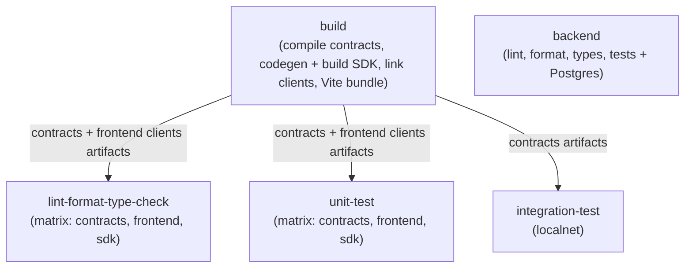

# CI

This page describes the GitHub Actions setup: a consolidated
[`build-and-test`](.github/workflows/build-and-test.yml) workflow
plus a separate [`markdown-lint`](.github/workflows/markdown-lint.yml), and
the reasoning behind the split.

## Principles

- **Build once, share the output.** The generated contract artifacts (TEAL +
  ARC specs), the frontend's linked typed clients, and the SDK's
  `src/generated/` clients are gitignored and regenerable. One `build` job
  produces them and uploads them as artifacts; downstream jobs download what
  they need instead of recompiling.
- **Split by prerequisites.** Lint/format/type-check and unit-test jobs need
  only Node.js, so they never install the heavier toolchain. The `build` job
  needs the AlgoKit CLI (Python) and no Docker; the `integration-test` job
  needs Docker. Keeping those in separate jobs (not separate workflows) keeps
  feedback fast and failures attributable to the right lane.
- **Parallel lanes per project.** `contracts`, `frontend`, and `sdk` are
  independent npm projects; the per-project jobs run them side by side via a
  matrix. The backend runs as its own job (it needs a Postgres service, so it
  doesn't fit the pure-Node matrix).
- **CI calls the per-project npm scripts directly** (`npm run lint`, …), not
  `algokit project run`. The algokit wrapper is a local convenience and runs
  projects sequentially.
- **Run once per change.** Both workflows trigger on `pull_request` (any branch)
  and on `push` to `main` only - a same-repo branch would otherwise fire both
  `push` and `pull_request` events and run everything twice.

## Job graph

## What each job needs

| Job | Node.js | AlgoKit CLI | Docker | Artifacts it consumes |
| --- | --- | --- | --- | --- |
| `build` | ✅ | ✅ | - | - |
| `lint-format-type-check` | ✅ | - | - | contracts + frontend clients |
| `unit-test` | ✅ | - | - | contracts + frontend clients |
| `backend` | ✅ | - | ✅ (Postgres service) | - |
| `integration-test` | ✅ | ✅ | ✅ (algod + indexer) | contracts artifacts |
| `markdown-lint` (own workflow) | ✅ | - | - | - |

Key point: **lint/format/type-check, unit-test, and markdown are pure Node**.
`eslint`, `prettier`, `tsc`, `vitest`, and `markdownlint-cli2` need no Docker
or AlgoKit install; they only download the `build` job's artifacts and run the
SDK's codegen (the sdk lane) or build the SDK (the frontend lanes) - see below.
The backend lane is the exception: its suite runs against a throwaway Postgres
service (migrations first, like local development).

## Why the SDK and frontend need the build's output

The SDK's write path imports the generated contract clients (`src/generated/*`,
gitignored), which `scripts/codegen.mjs` copies out of the contracts' build
artifacts (TEAL + ARC-56 specs). The SDK's **type-check** and **tests** resolve
those imports, so the `sdk` lane downloads `contracts-artifacts` and runs
`npm run codegen` first (no AlgoKit needed - codegen only copies when the
artifacts are already present).

## Why the frontend lanes build the SDK

The frontend consumes `@kasakame/sdk` as `"@kasakame/sdk": "file:../sdk"` with
a prebuilt `dist/` (see [`sdk.md`](sdk.md)), so **both the frontend type-check
and its unit tests resolve that `dist/`**. The `lint-format-type-check` and
`unit-test` frontend lanes therefore install the SDK's dependencies and build it
before running their scripts (`tsc` emit, seconds; the SDK's prebuild codegen
copies the generated clients out of the `contracts-artifacts` those lanes also
download). Cheaper to rebuild per lane than to shuttle another artifact. The
frontend's own `pre*` npm hooks rebuild it on demand for local dev.

## Workflow: build-and-test

Implemented at `.github/workflows/build-and-test.yml`. Five jobs, with
`build` as the upstream dependency:

- **`build`** - installs Node + AlgoKit, compiles the contracts (`npm run
  build` → TEAL + clients), builds the SDK (`npm run build`; its prebuild
  codegen copies the compiled clients and ARC-56 specs into `src/generated/`),
  links the clients into the frontend (`algokit project link --all`), tags them
  so `tsc` skips them (`scripts/ts-nocheck-generated.mjs`), bundles the
  frontend (`npx vite build`), and uploads two artifacts:
  `contracts-artifacts` and `frontend-clients`.
- **`lint-format-type-check`** - matrix over `[contracts, frontend, sdk]`. The
  frontend lane downloads `frontend-clients`; the sdk and frontend lanes
  download `contracts-artifacts` (the sdk lane runs `npm run codegen`, the
  frontend lane's SDK build does it via its prebuild hook). Then each lane runs
  lint, format, and type-check. `fail-fast` is off so one project's failure
  doesn't cancel the other lanes.
- **`unit-test`** - matrix over `[contracts, frontend, sdk]`. The same
  artifact/codegen downloads as the lint lane, then each lane runs
  `npm run test:coverage`.
- **`backend`** - standalone (needs nothing from `build`): starts a Postgres
  service, runs migrations, then lint, format, type-check, and
  `npm run test:coverage` - the same sequence as local development.
- **`integration-test`** - downloads `contracts-artifacts`, starts LocalNet,
  and runs the compiled TEAL against a live algod.

`npm run format` runs Prettier in `--check` mode, so style drift fails the build
without modifying files.

## Workflow: markdown-lint (separate file)

Implemented at `.github/workflows/markdown-lint.yml`. Markdown linting gets its
**own workflow file**, because triggers live at the workflow level - a job
cannot have a different trigger than its workflow. Splitting it allows a
`paths:` filter so the markdown job only runs when docs (or the markdownlint
config) change.

This also gives markdown its own status check, so a docs failure isn't buried
under the per-project matrix. The lint command checks all
`*.md` files; the `paths:` filter limits runs to docs changes.

## Testing taxonomy

Contracts and frontend test differently. Contract suites are offline AVM tests
with a 100% lines/branches/functions gate; frontend suites are Vitest unit +
component tests with a 100% gate on components and utils. The SDK's suite is
pure Vitest over the chain layer (claim-tree math, replay, campaign reads, and
writes) with a 100% gate on `src`; its lane runs the codegen first so the
generated clients resolve at import time. All are described in
[`testing.md`](testing.md) (contracts) and [`frontend.md`](frontend.md) (frontend).

The offline contract tests don't need the AlgoKit CLI or Docker because the
`algorand-typescript-testing` transformer runs the contract source directly
under Node. That's why the unit-test job is pure Node - it only consumes the
frontend clients artifact for import resolution, never the compiled TEAL.

## Caching

No custom Docker image is built or pulled for any job. Tooling installs on
the runner and caches:

- **Node** - `actions/setup-node@v7` with `cache: npm` and
  `cache-dependency-path` pointing at the project's `package-lock.json`. This
  caches `node_modules`, so `npm ci` is ~seconds on cache hits. (Three setup-node
  steps in `build`, one per project's lockfile.)
- **AlgoKit (Python)** - installed fresh via `pipx` in the `build` and
  `integration-test` jobs (not cached). The install is fast relative to the
  Docker container startup that dominates the integration job.

The only Docker in CI is **prebuilt** images: the Postgres service (backend
job) and the algod/indexer sandbox (integration job, pulled only there). If runner install time ever justifies a custom
CI image, publish it once to GHCR and rebuild only when its `Dockerfile` changes.

## Artifacts - sharing build output between jobs

The `build` job uploads two artifacts that downstream jobs download, so nothing
is compiled twice:

- **`contracts-artifacts`** - `projects/contracts/smart_contracts/artifacts`
  (TEAL, ARC-32/56 specs). Consumed by `integration-test`, and by
  `lint-format-type-check` and `unit-test` (the sdk lane runs the SDK's codegen
  on it; the frontend lane's SDK build does the same).
- **`frontend-clients`** - `projects/frontend/src/contracts` (the linked typed
  clients). Consumed by `lint-format-type-check` (frontend lane) and
  `unit-test` (frontend lane).

Downstream jobs download these artifacts instead of recompiling, so the
consumer jobs get freshly generated clients without an AlgoKit install.
